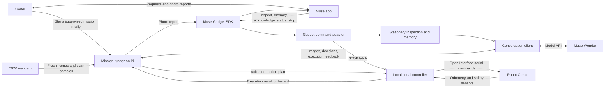
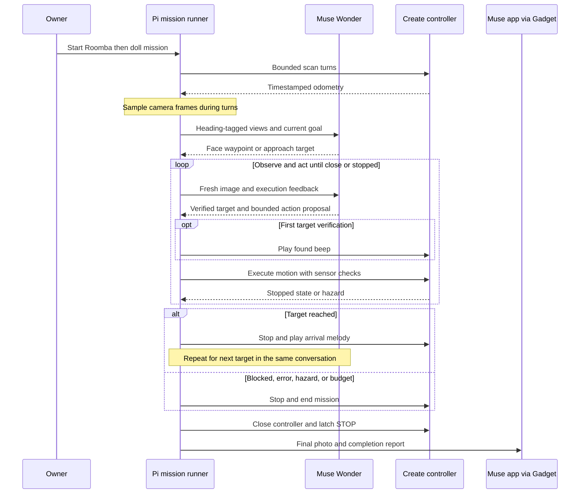

# R1D1

A Meta AI Developer Hackathon project.

A supervised iRobot Create + Raspberry Pi robot that finds a visual target,
approaches it, and reports to its owner through Muse. The working demo finds
a doll wearing an **I ♥ AI** shirt, or chains a **black Roomba → doll** mission.

Muse Wonder interprets images, remembers the mission conversation, chooses
scan headings and approach distances, and decides when to stop. A local
controller validates commands, monitors Create safety sensors, and stops on
errors, hazards, deadlines, or the STOP latch.

## How it is wired



The live movement task starts through the supervised local CLI. Gadget commands
support inspection, memory, acknowledgment, status, and stop; they do not expose
an autonomous motion command. Wonder supplies visual reasoning and approximate
distance estimates. The Pi controller executes commands and monitors sensors.



The loop also ends on a blocked view, model/API error, hazard, owner stop, or
mission budget. A failed stage does not count as a completed multi-target mission.

## Current demo

1. Sample camera frames during a 180° scan; send up to seven heading-tagged views
   to Wonder together.
2. Face a promising direction and inspect fresh forward images.
3. Verify the target's description and play the **target located** sound once.
4. Let Wonder estimate a conservative approach distance. Longer plans execute
   as motor segments of at most 500 mm, without another model request between
   segments. There is no visual reassessment during a segment or between segments
   of the same plan; hardware hazard checks remain active.
5. Stop at Wonder's chosen proximity, play the **arrival** melody, and send a
   final photo through Muse. Every exit leaves the STOP latch set.

Longer approaches run at **80 mm/s**. Short adjustments use 60 or 40 mm/s.
The attempted 120 mm/s increase triggered immediate wheel overcurrent stops on
the rug and was reverted. Do not disable overcurrent protection to speed up a demo.

Wonder uses high reasoning for search and medium reasoning after target
verification. Conversation output, including opaque encrypted reasoning, is
replayed across calls and saved privately under `runtime/`. Sessions are bound
to their model; encrypted histories are not transferred between models.

## Parts list

| Component | Role in this build |
|---|---|
| Original iRobot Create and its rechargeable battery | Wheels, wheel odometry, bump/cliff/wheel-drop sensors, and built-in status beeper |
| Raspberry Pi 5 | Runs the camera service, mission conversation client, and local motor/safety controller |
| External battery / power bank for the Pi | Powers the Pi separately from the Create's drive battery; exact model and capacity are not recorded here |
| Logitech HD Pro Webcam C920 | USB camera used for the demonstrated scans, target identification, and approach loop |
| Raspberry Pi camera module | Installed alternate camera; not used in the current C920-based mission and not a calibrated depth sensor |
| USB-to-Create serial connection | Connects the Pi to the Create Open Interface at 57600 baud |
| Wi-Fi connection and owner's phone with Muse | Connect the Pi to the cloud model and deliver inspection requests and photo reports |

The two cameras do not provide calibrated stereo depth. The Create's beeper
provides the found/arrival sounds; no separate speaker is required for this demo.

## Models and services

| Model or service | Use |
|---|---|
| **Muse Wonder** (`muse-wonder-1.0`) via Meta Model API | Active model: interprets images, maintains mission context, identifies targets, estimates approach distances, and proposes actions |
| Muse Spark 1.3 (`muse-spark-1.3`) | Optional alternative tested on saved images; not used in the demonstrated live mission |
| Muse Gadget SDK and Muse app | Device integration, stationary inspection commands, owner acknowledgment, stop requests, and photo-report delivery; these are not additional vision models |

Cloud access requires a Meta Model API key and a paired Muse Gadget installation.
Motion and sensor checks run locally on the Pi; visual reasoning runs in the cloud.

## Software dependencies

- Raspberry Pi running Linux; development tests also run on macOS.
- Create serial interface at `/dev/ttyUSB0`.
- Fresh-frame C920 HTTP service on port 8080.
- `ffmpeg` for the webcam service. Pi-camera helpers also require the owner's
  existing `~/scout-snap` script and `rpicam-still`.
- Python 3.10+ recommended (the live Pi uses 3.13).

The webcam device ID in `webcam_stream.py`, serial path in `oi.py`, and service
user/paths in the supplied systemd units are specific to the current robot.
Review them before installing on another device. `camera-config.json` selects
the cameras. No credentials belong in this file or repository.

## Local development

```sh
python3 -m venv .venv
.venv/bin/python -m pip install -r requirements-dev.txt
.venv/bin/python -m unittest discover -s . -p 'test_*.py' -v
```

These are mocked/synthetic regression tests: they do not intentionally move the
robot, contact the model API, or require a real API key. The live doll task is
an **end-to-end integration benchmark**, separate from these tests.

On the Pi, the existing environment uses `--system-site-packages` and Debian's
`python3-opencv`. Keep that working environment; do not replace its OpenCV with
a second pip installation merely to match the development setup.

## Live operation

Keep a human beside the power switch, use a lit single-level area, block stairs,
and clear loose objects from the wheels. Starting this script explicitly resets
the STOP latch after taking the exclusive mission lock and passing API preflight.
It is an opt-in motion command, not a passive inspection:

```sh
cd ~/r1d1
.venv/bin/python target_approach.py
```

Targets can also be chained in one conversation. The robot stops and plays an
arrival melody at each completed target before searching for the next:

```sh
.venv/bin/python target_approach.py --target 'black Roomba robot vacuum' --then 'doll wearing an I heart AI shirt'
```

Each stage has an eight-minute and four-metre travel budget. A blocked or failed
stage ends the mission; the final report distinguishes partial completion from
success. Timing includes per-stage verification and arrival milestones.

The key is read from `META_MODEL_API_KEY` or the existing private file
`~/.config/r1d1/meta_api_key`. Muse Gadget must already be installed and paired
for photo reports. SDK acceptance does not establish that the owner read them.

Default model: `muse-wonder-1.0`. Standard Spark 1.3 can be selected explicitly:

```sh
R1D1_MODEL=muse-spark-1.3 .venv/bin/python target_approach.py
```

In a small saved-image comparison, Spark was cheaper but slower than Wonder at
medium reasoning; it is not the default. Contributor mode has different data-use
terms and has not been used for the household-image comparison.

## Timing and evidence

Each mission saves `runtime/target-<id>/result.json`, `events.jsonl`, and its
private `conversation.json`. `runtime/run-benchmarks.jsonl` records success,
time to verification/arrival, total elapsed time, and phase totals for scan,
camera, model, movement, sound, and delivery. Failed calls are timed too.

For comparisons, reset the robot and doll to the same positions and heading,
with the same surface and lighting. Record failures as well as successful runs.
Arrival time excludes final sound/report cleanup; total elapsed includes them.
Scan time includes concurrent frame sampling, so its internal capture time is
not counted again under the separate camera phase.

Latest successful carpet run: **89.0 s to arrival**, **95.8 s including report
cleanup**, 51.2 s in seven model calls, 9.4 s scanning, and 23.6 s moving. The
robot reported no sensor hazards; the remaining gap was visually estimated,
not physically measured. Run ID: `target-f8449c0c`.

Private photos, session histories, calibration files, logs, and local review
snapshots stay in ignored directories. They are preserved on disk, not included
in Git. Retired experiments are preserved in an ignored `review/pre-prune-*.tar.gz`
archive on the local machine. Superseded bot scripts are backed up before retirement.

## Muse and maintenance tools

`register_commands.py` installs the read-only `inspect`, `memory`,
`status`, explicit-owner `acknowledge`, and emergency `stop` Gadget commands.
It uses passwordless sudo to install definitions under
`/etc/musegadget/commands.d` and restart `musegadget`. Run it only when deliberately
updating the device integration. It does not register the autonomous doll task
as a remotely callable motion command.

`inspect_demo.py` retains the scoped,
one-hour acknowledgment flow: changed or uncertain observations are not suppressed.

`calibrate_camera.py` generates a checkerboard and fits webcam intrinsics from
diverse views; its private results stay under `runtime/`. `supervised_test.py`
retains fixed sensor, stop, and small-motion hardware checks. Its drive and turn
commands physically move the robot and require deliberate supervision and an
inspected, explicitly cleared STOP latch.

The optional visual-memory dashboard binds to `127.0.0.1:8090`. Access it through
an SSH tunnel; it shows private room images. The existing camera service on port
8080 is LAN-accessible. Review network exposure before using a different network.

## Source guide and limits

| Files | Purpose |
|---|---|
| `target_approach.py` | Current doll mission and strict plan validation |
| `brain.py` | Model API, private conversation replay, usage accounting |
| `oi.py` | Exclusive serial worker, bounded moves, sensor and STOP checks |
| `scan_batch.py`, `camera.py`, `webcam_stream.py` | Scan sampling and fresh camera frames |
| `sound_effects.py`, `run_timing.py` | Status sounds and benchmark timings |
| `gadget_command.py`, `register_commands.py` | Muse Gadget integration |
| `inspect_demo.py` | Stationary target inspection, photo reports, and acknowledgments |
| `visual_memory.py`, `pose_graph.py`, `memory_command.py`, `map_viewer.py` | Experimental visual revisits and saved-map reports |
| `calibrate_camera.py`, `supervised_test.py` | Camera calibration and deliberate hardware checks |

There is no calibrated depth sensor, occupancy map, or reliable whole-house
navigation. Scan headings and travel distances use drifting wheel odometry.
Monocular distance estimates can be wrong. The front-entry navigation attempts
did not reach their destination. This is a supervised research prototype.

## License

Copyright 2026 Emon ([shahrier](https://github.com/shahrier)).

Licensed under the [Apache License, Version 2.0](LICENSE).
